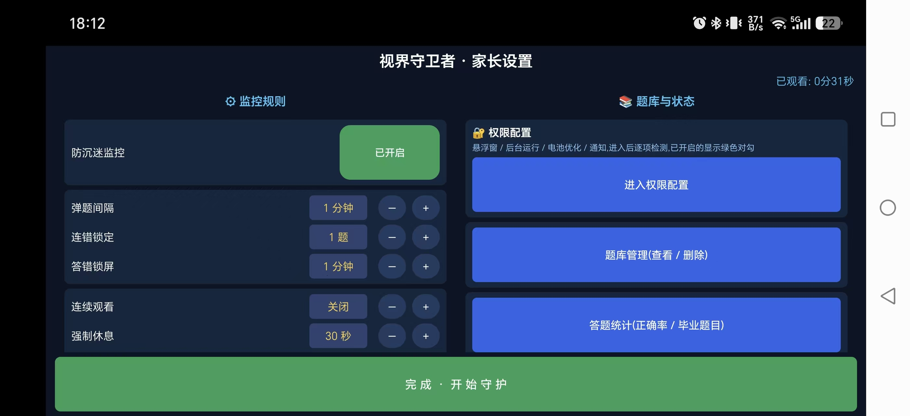
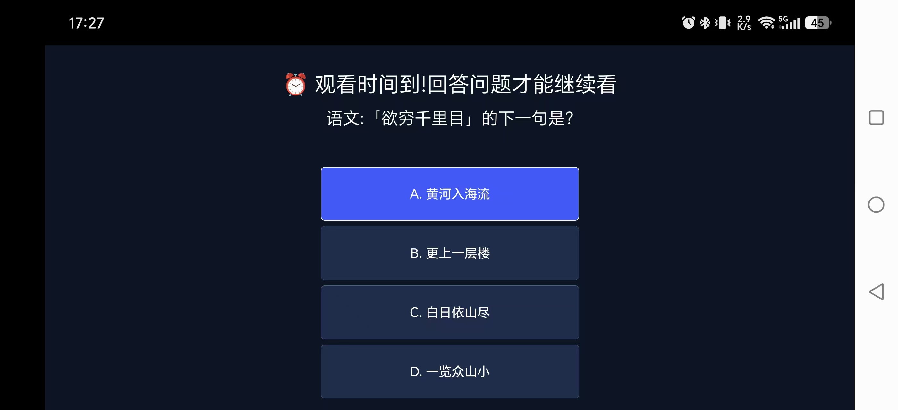
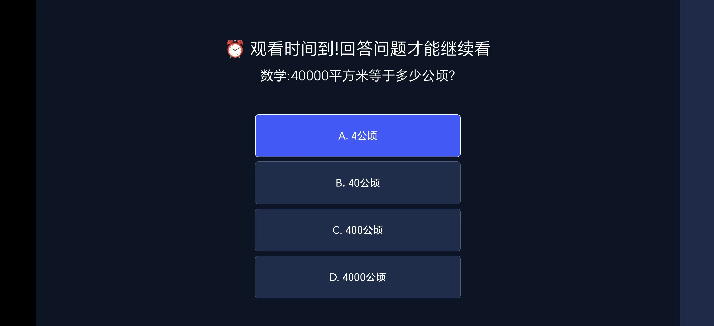
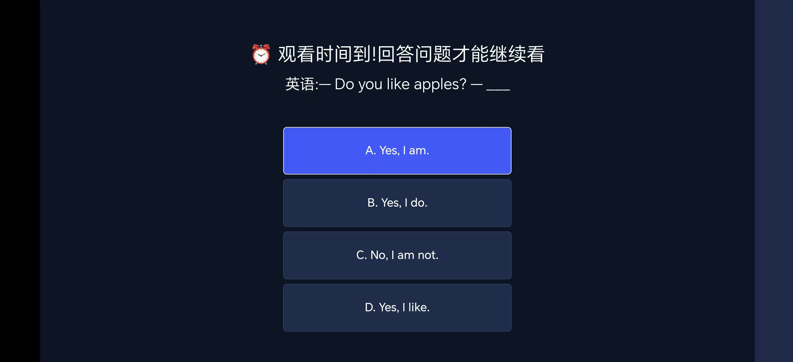
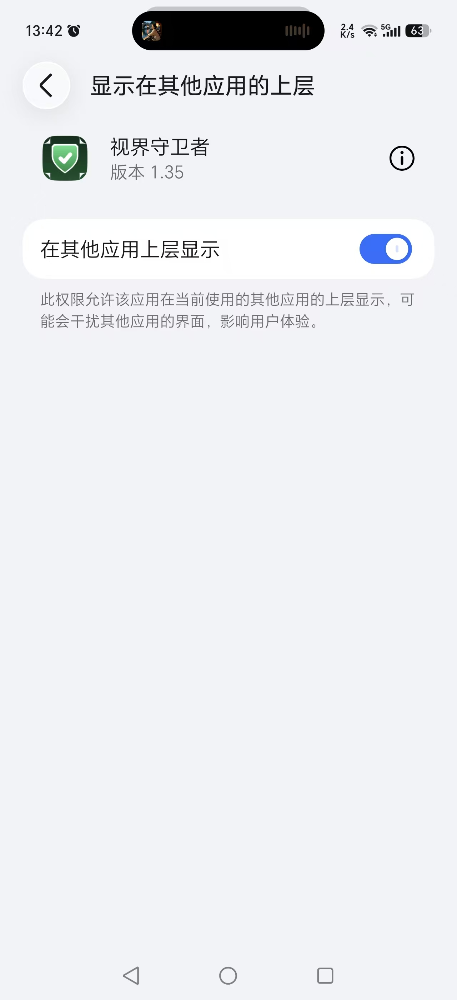
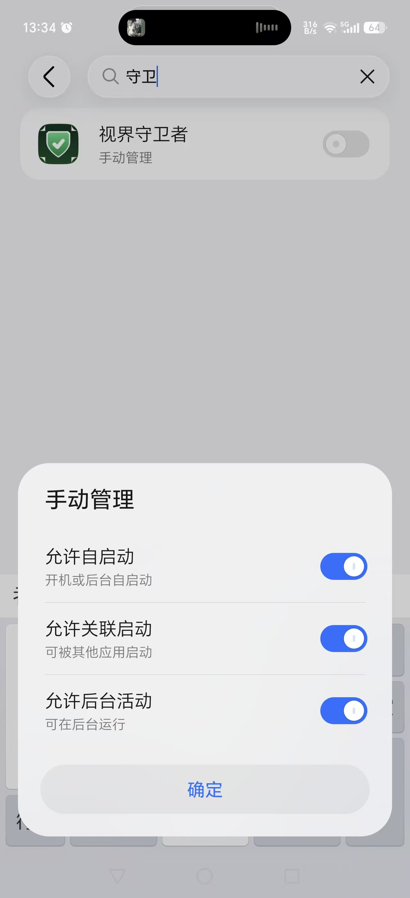

# 视界守卫者(Android TV 儿童防沉迷)

一个装在**安卓电视/电视盒子/手机**上的儿童观看防沉迷应用:

- 每连续观看 **10 分钟**(可调),自动**尝试暂停播放**并弹出**全屏答题**界面,盖住画面;
- 答对播放鼓励音后继续;答对 5 次的题目自动"毕业"不再出现;全部答完需家长密码解锁;
- **连续答错 3 题**(可调)→ 锁定 **10 分钟**(可调),全屏倒计时强制休息;
- **强制休息**:可配置每连续观看 N 分钟不看题直接锁定 M 分钟(独立于答题,0=关闭);
- 家长可查看**答题统计**(每题答对/答错次数、正确率、毕业状态),支持一键重置;
- 题库自定义:**Excel 模板** → 浏览器转换器 → JSON,支持 **U盘导入** 和 **手机局域网上传**;
- 内嵌**四年级题库 100 题**(语文30/数学40/英语30),可删除/恢复;
- 设置界面有**家长密码**保护(修改密码需二次确认;离开前台即重新上锁);
- 防按键绕过:返回/菜单键拦截、屏幕固定、主页逃出后秒级自动拉回。

## 界面预览

**家长设置**(左右双栏,一屏显示全部配置)

<p align="center">
  
</p>

**全屏答题(盖住视频画面,语/数/英随机出题)**

| 语文 | 数学 | 英语 |
|:---:|:---:|:---:|
|  |  |  |

## 权限配置(重要,手机安装必看)

电视盒子一般装完即用;国产手机 ROM 需要手动放开两个权限,否则弹题会被系统拦截:

**1.「显示在其他应用的上层」**——设置页有快捷授权入口,或手动到系统设置开启:

<p align="center">
  
</p>

**2.「启动管理」三项全开**——允许自启动、允许关联启动、允许后台活动
(华为/荣耀:设置 → 应用 → 应用启动管理 → 视界守卫者 → 手动管理;小米:「自启动」+「后台弹出界面」;OPPO/vivo 类似名称)

<p align="center">
  
</p>

**3.「电池优化」加入白名单**——设置页有「加入电池白名单」按钮,防止省电策略冻结后台计时。

设置页右栏只有一个「🔐 权限配置」入口(有未开启项时变橙色提醒),点进去是统一权限页:悬浮窗 / 后台运行 / 电池优化 / 通知四项,可自动检测的项显示**绿色对勾**,后台运行权限需手动标记「我已全部开启」,顶部显示「已开启 X/4 项」,从系统设置返回时自动刷新。诊断信息默认折叠在标题下方。下拉通知栏会常驻一条**状态条幅**,实时显示「已观看 X分XX秒 · 距下次答题 Y分」——既是后台保活手段(参考华为健康做法),也让家长随时掌握观看时长。

**提示**:常驻条幅在 Android 7~14 均生效;部分 ROM 需允许「通知」自启动后才显示,属于同一套后台权限。

## 目录内容

| 路径 | 说明 |
|------|------|
| `app/` | Android 工程源码(纯 Java + 系统 API,零第三方依赖,兼容 Android 5.0 ~ 14+) |
| `capture/` | 界面与权限配置截图 |
| `题库工具/题库模板.xlsx` | 家长用 Excel 出题模板 |
| `题库工具/转换器.html` | 浏览器打开即可把 Excel 转成 JSON(无需安装软件) |
| `题库工具/四年级题库-100题.json` | 四年级题库(已内嵌进 APK,此处供参考/编辑) |
| `题库工具/题库格式说明.md` | 题库格式与导入方法详细说明 |
| `release.keystore` | 正式签名密钥(签名一致才能覆盖升级) |

## 安装使用

1. **安装 APK**:项目根目录或构建输出中的 `tvguard-vX.Y.apk`(正式签名版),经U盘或 `adb install` 安装;
2. 首次打开,设置**家长密码**(4-8位数字,请牢记;忘记只能卸载重装);
3. 按上面「权限配置」授予悬浮窗与启动管理权限;
4. 出题方式三选一:
   - 使用内嵌的四年级题库 100 题(可在题库管理中删除);
   - 填 Excel 模板 → `转换器.html` 转出 JSON → U盘导入;
   - 家长设置页开启"局域网上传",手机浏览器访问电视显示的地址上传 JSON;
5. 点底部「完成 · 开始守护」→ 界面退到后台,计时立即开始;
6. 让孩子正常看视频即可,到时间会自动弹题。

## 快速验证(建议)

家长设置页可把"弹题间隔"调到 **1 分钟**,先把整个流程跑通(弹题→答对恢复→连错3题→锁定→自动恢复),再改回 10 分钟。

## 诚实的能力边界

- "暂停"是通过发送**媒体暂停键**实现的,绝大多数播放器会响应;个别播放器不响应时,画面仍会被答题界面完全盖住,只是声音可能继续;
- 主页键无法被普通应用直接拦截:通过**屏幕固定**(锁定任务)阻止,普通模式需用户确认一次且长按返回可解除;用 ADB 设为**设备所有者**后固定静默生效、无法解除:
  `adb shell dpm set-device-owner com.parental.tvguard/.GuardDeviceAdminReceiver`
- 国产手机 ROM 会限制后台弹窗(华为/荣耀需"启动管理"三项全开,小米需"后台弹出界面");未放开时 App 会自动重试并自愈,不会冻结计时,但需要家长授权才能正常弹题;
- 普通应用无法阻止孩子**卸载**本应用或从系统设置强停,家长密码保护的是设置项;
- 服务被系统杀掉后会自动重启(START_STICKY + 看门狗闹钟 + 开机自启)。

## 构建(开发者)

需要安装 JDK 17+ 和 Android SDK(推荐直接装 Android Studio),然后:

```bash
# 在 local.properties 中配置 sdk.dir(或设置 ANDROID_HOME 环境变量)后:
./gradlew assembleRelease
# 产物: app/build/outputs/apk/release/tvguard-vX.Y.apk(自动按版本号命名)
```

首次构建会自动下载 Gradle 8.6 和 AGP,运行时零第三方依赖。

- minSdk 21(Android 5.0),targetSdk 33,compileSdk 34;
- 构建产物统一命名 `tvguard-v版本号.apk`。

## 签名

正式版使用项目根目录 `release.keystore` 签名(alias `tvguard`,密码 `tvguard2024`)。
**请妥善保管该文件**:签名不一致将无法覆盖安装。

## 更新记录(近期)

- v1.35:修复弹题重复触发(待显示期间不再重复弹);诊断信息默认折叠
- v1.34:识别 ROM 压制后台悬浮窗场景并自愈;诊断显示厂商 + 厂商权限引导
- v1.33:修复弹窗状态机死锁;新增弹窗通道诊断
- v1.32:悬浮窗答题拦截返回/菜单键
- v1.31:弹题握手以窗口焦点为准,后台创建不再假成功
- v1.30:弹窗被拦截时状态栏显示原因 + 通知提醒
- v1.29:添加作者与版权信息
- v1.26:进程冻结自愈(看门狗补执行答题切换)
- v1.24:看门狗闹钟防 ROM 冻结后台;冻结期时间补偿

## 作者

**WangQingshan** — [github.com/qingshanw](https://github.com/qingshanw)

## 开源许可

Apache License 2.0 — Copyright (c) 2026 WangQingshan
